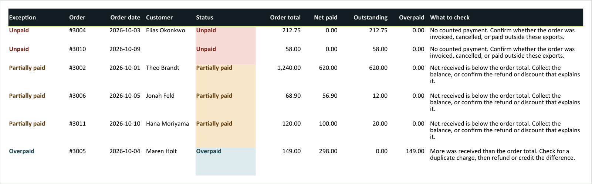
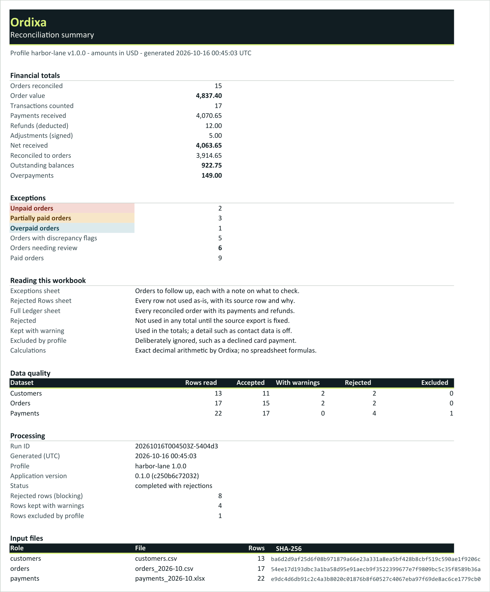
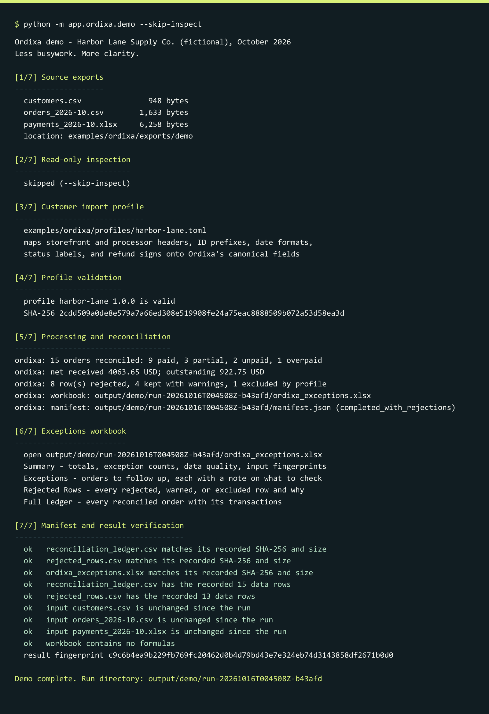
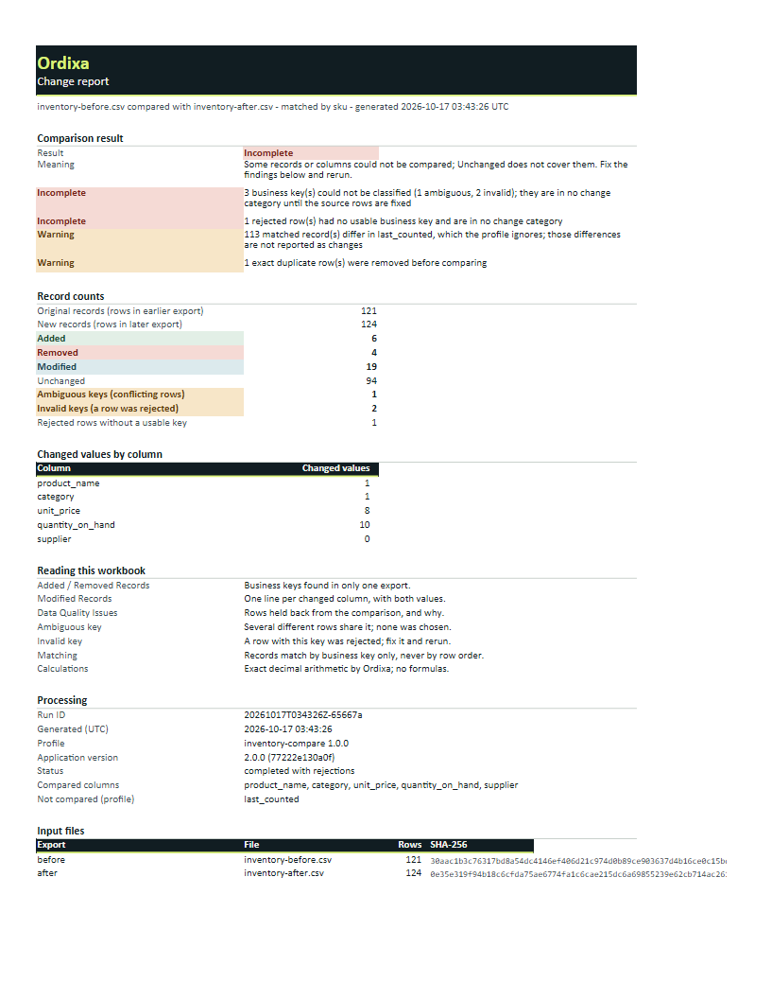

<p align="center">
  
</p>

# Ordixa
<p align="center">
  <a href="https://github.com/quangshuynh/ordixa/actions/workflows/ci.yml">
    
  </a>
  <a href="https://github.com/quangshuynh/ordixa/releases">
    
  </a>
  
</p>

**Less busywork. More clarity.**

Ordixa automates spreadsheet cleaning, data validation, financial
reconciliation, and business reporting for small businesses. It reads the
CSV and Excel exports a business already has, applies rules written once in a
short TOML profile, and writes reviewable workbooks and CSVs with a manifest
that can be verified later. Everything runs locally; no database, account, or
network access is needed.

## Three workflows

| Workflow | Command | Turns | Into |
| --- | --- | --- | --- |
| **Reconcile** orders and payments | `run` | storefront orders, processor payments, optional customers | paid / partial / unpaid / overpaid ledger, exceptions workbook, exact totals |
| **Clean** one table | `clean` | an inconsistent CSV/XLSX export | a typed, standardized CSV plus every held-back row and why |
| **Compare** two versions | `compare` | last week's and this week's export | added, removed, and modified records by business key, in a change report |

All three share the same foundation: exact decimal parsing, identifiers kept
as exact text, duplicates and conflicting records held back instead of
guessed, formula-injection protection, atomic run directories, and
checksummed manifests. A read-only `check-profile` previews how a profile
will read the files, and `verify` re-checks a finished run before delivery.

<p align="center">
  
</p>
<p align="center"><em>Exceptions sheet from the fictional reconciliation demo, rendered from the generated workbook.</em></p>

<table>
  <tr>
    <td width="50%"></td>
    <td width="50%"></td>
  </tr>
  <tr>
    <td><em>Reconciliation Summary: totals, exceptions, data quality, input fingerprints.</em></td>
    <td><em>The guided demo, from source exports to verified manifest.</em></td>
  </tr>
</table>

<p align="center">
  
</p>
<p align="center"><em>Change report Summary from the fictional inventory comparison: the result and its findings come first.</em></p>

More in the [screenshot gallery](docs/DEMO.md).

## Quick start

Prerequisites: Python 3.14 (the version CI uses) and Git. Ordixa runs from
a source checkout.

```bash
git clone https://github.com/quangshuynh/ordixa.git
cd ordixa
python -m venv .venv
source .venv/bin/activate        # Windows PowerShell: .venv\Scripts\Activate.ps1
python -m pip install -r requirements.txt
python -m app.ordixa --version
```

## Try it on fictional data

Each demo runs end to end and verifies its own output:

```bash
python -m app.ordixa.demo             # reconcile the Harbor Lane orders and payments
python -m app.ordixa.inventory_demo   # clean and compare two weeks of inventory
```

Or run the steps yourself. Reconciliation:

```bash
python -m app.ordixa inspect --input examples/ordixa/exports/demo
python -m app.ordixa check-profile --profile examples/ordixa/profiles/harbor-lane.toml \
  --input examples/ordixa/exports/demo --explain
python -m app.ordixa run --profile examples/ordixa/profiles/harbor-lane.toml \
  --input examples/ordixa/exports/demo --out output/demo
```

Cleaning and comparison:

```bash
python -m app.ordixa clean --profile examples/ordixa/profiles/inventory-clean.toml \
  --input examples/ordixa/exports/inventory/inventory-before.csv --out output/inventory-clean
python -m app.ordixa check-profile --profile examples/ordixa/profiles/inventory-compare.toml \
  --before examples/ordixa/exports/inventory/inventory-before.csv \
  --after examples/ordixa/exports/inventory/inventory-after.csv
python -m app.ordixa compare --profile examples/ordixa/profiles/inventory-compare.toml \
  --before examples/ordixa/exports/inventory/inventory-before.csv \
  --after examples/ordixa/exports/inventory/inventory-after.csv --out output/inventory-comparison
```

Every run creates a new `run-<timestamp>-<id>/` folder (`output/` is
git-ignored) and ends by printing the `verify` command for it. A comparison
also says whether it is complete, complete with warnings, or incomplete, so
missing columns or unreadable records are never passed off as unchanged.

## Documentation

| Document | Contents |
| --- | --- |
| [docs/ORDIXA.md](docs/ORDIXA.md) | CLI reference, exit codes, reconciliation profiles, preflight, workbook, manifests |
| [docs/SPREADSHEET_WORKFLOWS.md](docs/SPREADSHEET_WORKFLOWS.md) | `clean` and `compare`: table profiles, previews, comparison result, outputs |
| [docs/DEMO.md](docs/DEMO.md) | Harbor Lane walkthrough, hand-computed results, screenshot gallery |
| [docs/MIGRATING_TO_V2.md](docs/MIGRATING_TO_V2.md) | What 2.0.0 changed, and profile and manifest compatibility |
| [docs/DATA_HANDLING.md](docs/DATA_HANDLING.md) | Receiving, processing, and deleting real customer files |
| [docs/pilot](docs/pilot/README.md) | Pilot kit: intake, scope, delivery checklist, owner decisions |
| [docs/ARCHITECTURE.md](docs/ARCHITECTURE.md) | Module layout, the original pipeline, API, dashboard, testing |
| [examples/ordixa](examples/ordixa/README.md) | Fictional exports, profiles, and hand-computed expectations |
| [CHANGELOG.md](CHANGELOG.md) | Release history |

## Limitations

Ordixa is a tested foundation exercised only on fictional data; it has no
validated customer deployments yet.

- **Exact matching only.** Payments match orders by a shared order
  reference, and compared records match by an explicit business key: no
  fuzzy, date, amount, or row-position matching, and conflicting rows are
  held back, never resolved.
- **One batch at a time.** A run covers only the files it is given; nothing
  persists between runs.
- **CSV and XLSX only**, one currency per profile, files up to 200 MB.
- **Profiles are written by hand**, and the demo exports imitate common
  vendor layouts without being official Shopify, Square, Stripe, or
  QuickBooks exports. Each real format needs a profile checked against
  samples.
- **A command-line tool**, run from a source checkout by an operator; no
  hosted app, accounts, scheduling, or vendor connectors.

Full lists: [reconciliation](docs/ORDIXA.md#known-limitations) and
[spreadsheet workflows](docs/SPREADSHEET_WORKFLOWS.md#known-limitations).

## Development and testing

```bash
python -m pip install -r requirements-dev.txt
python -m pytest -q
ruff check .
ruff format --check .
python -m scripts.release_check
```

CI runs these checks, then smoke-tests every command and both demos, on
every push and pull request. Releases follow [docs/RELEASING.md](docs/RELEASING.md).
The original Business Data Automation pipeline (`python main.py`, with
optional PostgreSQL, FastAPI, and a dashboard) is still included; see
[docs/ARCHITECTURE.md](docs/ARCHITECTURE.md).

## License

[MIT](LICENSE) © 2026 Quang. Ordixa grew out of the
Business Data Automation project in this repository.
