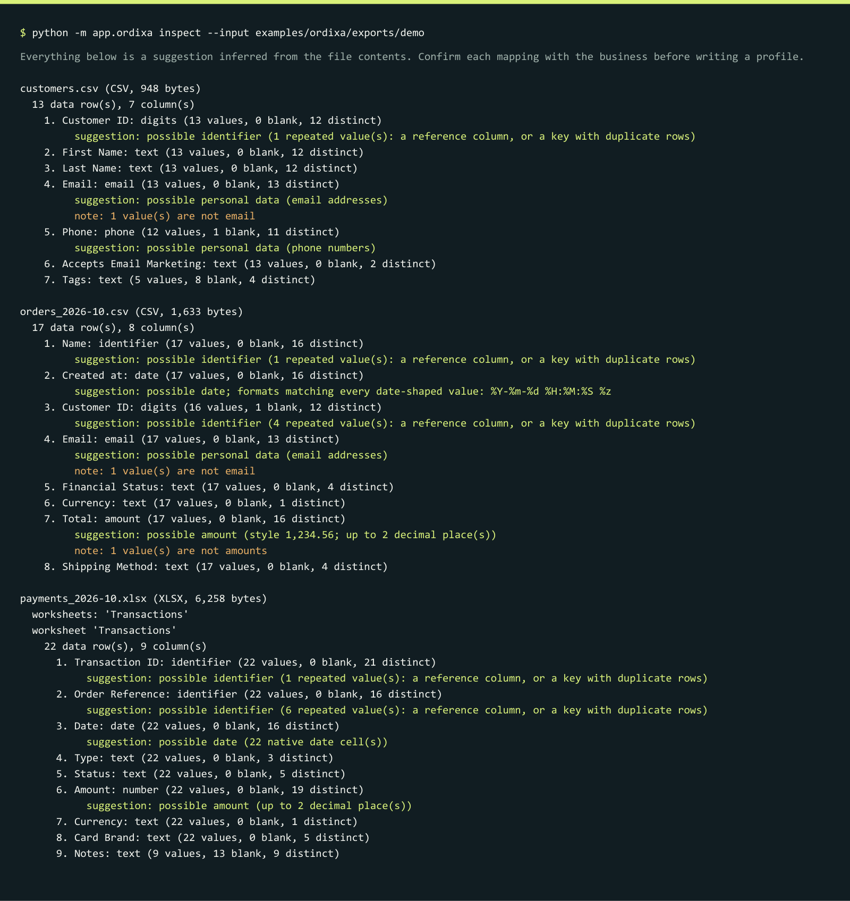
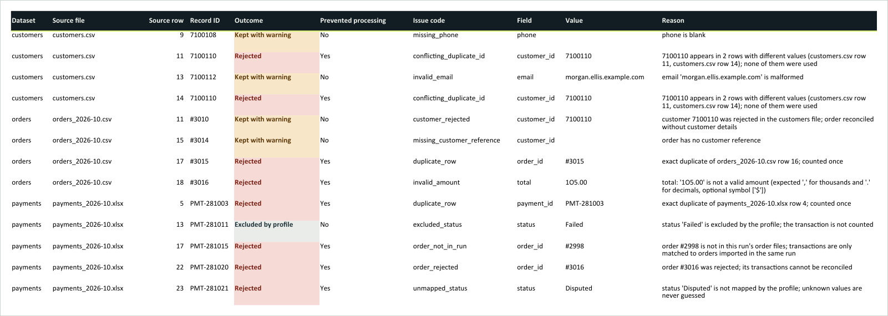
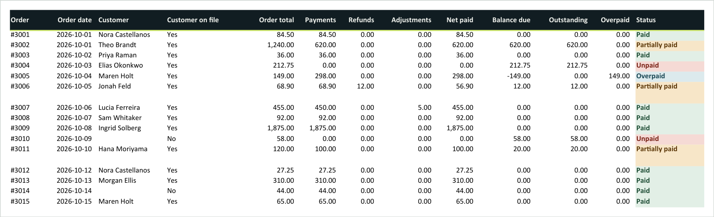

# Ordixa demo: Harbor Lane Supply Co.

A complete, reproducible walkthrough on entirely fictional data. Harbor Lane
Supply Co. is an invented online retailer; its customers, emails
(`example.com`/`.net`/`.org`), and phone numbers (`555-010-xxxx`) are made up.
The exports imitate a storefront and a payment processor, but they are **not**
official Shopify, Square, Stripe, or QuickBooks exports. The demo shows what
Ordixa does technically; it is not evidence of customer demand.

## Run it

From a fresh clone with the [Quick start](../README.md#quick-start)
prerequisites installed:

```bash
python -m app.ordixa.demo
```

No PostgreSQL, account, or network access is needed. The command prints seven
numbered steps and writes a new `output/demo/run-<id>/` directory.
`--skip-inspect` shortens the output; `--out <dir>` picks another git-ignored
or external location. The exit code is 0 only if every verification check
passes.

## The scenario

October 2026: one month of trading that needs reconciling before the books
close. Most rows are fine, and a handful need attention, as in a real review.

| File | Source system (fictional) | Format | Rows |
| --- | --- | --- | ---: |
| `customers.csv` | storefront customer export | CSV | 13 |
| `orders_2026-10.csv` | storefront order export | CSV | 17 |
| `payments_2026-10.xlsx` | processor transaction export | Excel, native date and number cells | 22 |

The files are in [`examples/ordixa/exports/demo`](../examples/ordixa/exports/demo)
and are processed with the customer's import profile,
[`harbor-lane.toml`](../examples/ordixa/profiles/harbor-lane.toml). That is
the same profile the compact test fixtures use: one profile serves every
month of exports.

## Walkthrough

### 1. Original exports

The storefront writes `#3001` order numbers and timestamps with offsets. The
processor writes `PMT-281001` transaction IDs, real Excel dates, and refunds
as negative numbers. Ordixa reads both formats and never modifies them.

### 2. Read-only inspection

Before writing a profile for unfamiliar exports, `inspect` describes them
without printing any cell values: headers, row counts, likely identifier,
date, and amount columns, personal-data columns, and anything odd.



The output already points at problems: a repeated customer ID, one email
that is not an email, a repeated order number, and one total that is not an
amount.

### 3. Customer import profile

[`harbor-lane.toml`](../examples/ordixa/profiles/harbor-lane.toml) declares,
in about 80 lines, how this customer's columns map to Ordixa's canonical
fields. It covers the `#` and `PMT-` prefixes, date formats, which status
labels mean paid or refunded, that refunds arrive negative, and that
`Failed` and `Voided` transactions moved no money. Nothing is guessed: an
unmapped label is an error.

### 4. Profile validation

```bash
python -m app.ordixa check-profile --profile examples/ordixa/profiles/harbor-lane.toml
```

Profiles are validated before any data is read. Every problem is reported at
once with its key path and a spelling suggestion.

### 5. Processing and reconciliation

```bash
python -m app.ordixa run --profile examples/ordixa/profiles/harbor-lane.toml \
  --input examples/ordixa/exports/demo --out output/demo
```

The terminal reports 15 orders reconciled (9 paid, 3 partial, 2 unpaid,
1 overpaid), net received 4,063.65 USD, outstanding 922.75 USD, 8 rows
rejected, 4 kept with warnings, and 1 excluded by profile.

### 6. The exceptions workbook

**Summary**: headline totals, exception counts, a guide to the workbook,
data quality per file, processing details, and the SHA-256 of every input.


**Exceptions**: the six orders to follow up, each with what to check next.


*Columns K–N (Transactions, Transaction IDs, Discrepancy flags, Source) are
left out of this capture for width.*

**Rejected Rows**: every row that was rejected, kept with a warning, or
excluded, with its file, row number, issue code, and a plain reason.



*Column K (Original values) is left out of this capture for width.*

**Full Ledger**: every reconciled order with its payment, refund, and
adjustment breakdown.



*Order ID, Customer ID, Customer email, Discrepancy flags, Transactions,
Transaction IDs, Last payment date, and Source are left out of this capture
for width.*

### 7. Manifest and result verification

`manifest.json` records the profile checksum, every input's SHA-256 and row
count, artifact checksums, totals, and a `result_fingerprint` that is
identical for identical inputs, profile, and code. The demo then re-checks
the run against its manifest.


## Expected results (computed by hand)

These values are typed into
[`tests/ordixa_golden.py`](../tests/ordixa_golden.py) independently of the
application, and the test suite compares every run with them.

| Order | Situation | Total | Net paid | Status | Outstanding | Overpaid |
| --- | --- | ---: | ---: | --- | ---: | ---: |
| #3001 | paid by card | 84.50 | 84.50 | paid | 0.00 | 0.00 |
| #3002 | wholesale, 50% deposit | 1,240.00 | 620.00 | partial | 620.00 | 0.00 |
| #3003 | paid; payment exported twice | 36.00 | 36.00 | paid | 0.00 | 0.00 |
| #3004 | net-30 invoice, unpaid | 212.75 | 0.00 | unpaid | 212.75 | 0.00 |
| #3005 | charged twice (two transaction IDs) | 149.00 | 298.00 | overpaid | 0.00 | 149.00 |
| #3006 | 12.00 refunded for a damaged item | 68.90 | 56.90 | partial | 12.00 | 0.00 |
| #3007 | paid plus a 5.00 freight adjustment | 455.00 | 455.00 | paid | 0.00 | 0.00 |
| #3008 | two installments | 92.00 | 92.00 | paid | 0.00 | 0.00 |
| #3009 | wholesale, paid | 1,875.00 | 1,875.00 | paid | 0.00 | 0.00 |
| #3010 | card declined (excluded) | 58.00 | 0.00 | unpaid | 58.00 | 0.00 |
| #3011 | processor says paid, but short | 120.00 | 100.00 | partial | 20.00 | 0.00 |
| #3012 | repeat customer, paid | 27.25 | 27.25 | paid | 0.00 | 0.00 |
| #3013 | paid; customer email malformed | 310.00 | 310.00 | paid | 0.00 | 0.00 |
| #3014 | guest checkout, paid | 44.00 | 44.00 | paid | 0.00 | 0.00 |
| #3015 | paid; order exported twice | 65.00 | 65.00 | paid | 0.00 | 0.00 |

Totals: order value 4,837.40; payments 4,070.65; refunds 12.00; adjustments
+5.00; net received 4,063.65; reconciled to orders 3,914.65; outstanding
922.75; overpaid 149.00.

### Rows that need attention

| File, row | Record | Outcome | Why |
| --- | --- | --- | --- |
| customers 9 | 7100108 | kept with warning | phone is blank |
| customers 11, 14 | 7100110 | both rejected | same ID with two different emails; neither is guessed |
| customers 13 | 7100112 | kept with warning | malformed email |
| orders 11 | #3010 | kept with warning | its customer record was rejected; money still reconciled |
| orders 15 | #3014 | kept with warning | guest order without a customer reference |
| orders 17 | #3015 | rejected copy | exact duplicate; counted once |
| orders 18 | #3016 | rejected | total `1O5.00` contains a letter O |
| payments 5 | PMT-281003 | rejected copy | exact duplicate; counted once |
| payments 13 | PMT-281011 | excluded by profile | `Failed` card payment moved no money |
| payments 17 | PMT-281015 | rejected | order #2998 belongs to an earlier export, not this run |
| payments 22 | PMT-281020 | rejected | its order #3016 was rejected |
| payments 23 | PMT-281021 | rejected | status `Disputed` is not in the profile |

PMT-281015 shows a current limitation: a run reconciles only the files it is
given, so a September order's late payment needs September's order file in
the same run.

## How the screenshots are made

Every image on this page comes from a real run of the demo. They are
regenerated with `python -m scripts.capture_screenshots`, which needs
LibreOffice and PyMuPDF and is not part of CI.

- **Workbook sheets** are the generated `ordixa_exceptions.xlsx` rendered by
  LibreOffice Calc. For width, each capture uses a copy with the columns
  named above left out and an A3 page; no cell values are changed.
- **Terminal images** are the exact text printed by `inspect` and by the
  demo, drawn in a monospace font. The scratch run directory is shown as
  `output/demo`, the demo's default.

Run IDs, timestamps, and the commit hash in the images differ from run to
run. Financial results and CSV artifacts do not.
